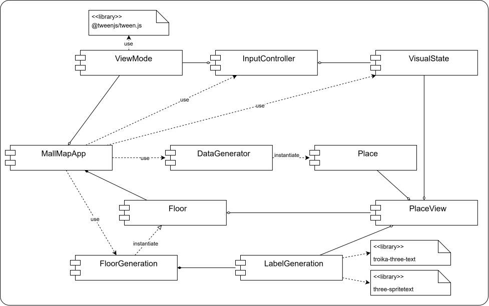

# Тестовое задание JS Three.js WebGL
### Техническое задание, версия 1.3

Проект реализует прототип визуализации для интерактивной карты торгового центра. Основная задача — динамическое построение сцены по массиву данных, отображение объектов (магазинов) с подписями и реализация переключения между 2D и 3D режимами.

Стек: JavaScript (ES6+), Three.js, WebGL. 

GitHub Pages: https://ekatherinas.github.io/interactive-mall-map-prototype/

## Инструкция по запуску

Для запуска проекта требуется выполнить следующие шаги:
1. Склонируйте репозиторий:
   ```bash
   git clone https://github.com/EkatherinaS/interactive-mall-map-prototype.git
   cd interactive-mall-map-prototype
2. Установите зависимости:
   ```bash
   npm i
4. Запустите проект в режиме разработки:
   ```bash
   npm run dev
После запуска dev-сервер будет доступен по адресу http://localhost:3000.

## Архитектура

<p align="center">
  
</p>

`MallMapApp` - точка входа в программу: он создаtт сцену, рендерер, все контроллеры и генераторы, связывает их и запускает `animate()`.

**Данные.** 
`DataGenerator` по числу генерирует массив `Place` (id, name, width, depth, color) — это чистые данные, ничего про 3D. 
Дальше `FloorGenerator` берет `Place[]`, расставляет их по сцене при помощи `ArrangeStrategy` (разные алгоритмы упаковки без пересечений), для каждого создает `Label` через `LabelFactory`, собирает `PlaceView` (3D-представление для `Place`) и складывает все в контейнер `Floor`.

**VisualState.** 
Это стратегия для выбора текущего состояния `PlaceView`: `DefaultStrategy`, `HoveredStrategy`, `SelectedStrategy`.

**LabelGeneration.** 
Фабрика для генерации подписей. Две реализации: `LabelTroikaFactory` (troika-three-text — SDF-текст, четкий на любом масштабе) и `LabelSpriteFactory` (three-spritetext — canvas-текстура для работы с большим количеством объектов). Дополнительно реализован метод для переноса текста по пробелам, если он не влезает в условную "максимальную длину строки".

**ViewMode.** 
Стратегии для переключения вида камеры. `Mode2D` — ортокамера сверху, `Mode3D` — перспектива под углом. При `switchMode()` контроллер запускает `TweenCamera`, которая плавно перетекает из одного вида в другой (`fov` + позиция), а по завершении переключает `activeCamera`. `getCamera()` во время tween возвращает промежуточную камеру. Здесь реализована некоторая комбинация перелета камеры и переключения проекции в связи с тем, что простое переключение проекции привело бы к рывкам, если перспективная камера смотрит не строго вниз, а простой перелет дал бы скачок при смене проекции.

**Интерактивность.** 
Два контроллера: `InputController` ловит события: `keydown`, `pointermove`, `pointerdown`. 
`InteractionController` делает raycast: по координатам мыши строит луч, через `userData.placeView` достает `PlaceView` и применяет `Hovered` или `Selected`.

<p align="center">
  
</p>

## Алгоритм размещения 100 объектов без пересечений

Реализованы два простых алгоритма упаковки без пересечений: LineStrategy и GridStrategy.

LineStrategy упаковывает все в одну линию: идет по массиву places и кладет их в ряд вдоль оси X. Работает с posX как с "бегущим курсором" на левом краю будущего меша. На каждом шаге: `posX += width / 2` (сдвинуться в центр меша), записать позицию, `posX += width / 2 + stride` (сдвинуться на правый край плюс зазор). Объекты гарантированно не накладываются, потому что каждый следующий начинается там, где закончился предыдущий, плюс зазор. Из недостатков: при 100 объектах линия уходит на несколько сотен единиц в длину.

GridStrategy упаковывает объекты в условную сетку. Сначала считает размер сетки: `gridWidth = ceil(sqrt(N))`, `gridDepth = ceil(N / gridWidth)` - то есть получает что-то максимально близкое к квадрату. Потом находит самый большой объект по ширине и по глубине отдельно, это и будет размер ячейки. Затем двойной цикл по строкам и столбцам: для каждого индекса `i * gridWidth + j` берет `places[ind]` и ставит его в центр ячейки. Алгоритм все еще достаточно простой, но решает проблему LineStrategy.

## Ответы на вопросы из раздела "Архитектура и оптимизация"

Представьте, что объектов станет не 100, а 1000, и они будут текстурированы.
1. *Опишите, как вы оптимизируете рендеринг текстовых подписей, чтобы они не тормозили сцену при большом количестве.*

На данный момент реализованы два варианта текстовых подписей: с применением библиотеки troika-three-text для генерации подписей, которые будут качественно отображаться вблизи, и с применением three-spritetext - для оптимизации рендера большого количества текстовых подписей и реализации билбординга. При дальнейших реализациях я бы посмотрела в сторону CSS2DRenderer или CSS3DRenderer.

Одним из вариантов того, как получить и качество, и производительность может быть подмена надписей при отдалении и приближении к мешу. Такое будет работать благодаря автоматическому frustum-culling - объекты вне фрустума не рендерятся и не ухудшают производительность. То есть, когда мы далеко нам не требуется качественное изображение подписей, но при этом мы рендерим все подписи, что заметно сказывается на требованиях к производительности. Когда мы приближается к подписи - наоборот - frustum-culling отсекает все подписи вне экрана и производительность уже не так нужна, как качество. Для этого потребуется остановится на одном из вариантов: билбординг или лежачий текст, и подобрать под него две реализации: с качественной картинкой и с хорошей производительностью. За это будем платить памятью: придется хранить два варианта надписей для каждого объекта и подменять их через перестановку visible-свойства.

Еще одним вариантом может быть генерация большой качественной текстуры с надписями, и простое добавление ее над мешами. Для динамических данных - при постоянно меняющихся названиях магазинов - нужно будет задумать о том, как ее перегенерировать.

2. *Объясните, как вы будете обрабатывать клики по объектам при использовании оптимизаций (например, если объедините геометрию)*

Зависит от того, о каких оптимизациях сейчас речь. Если о текстовых подписях, то их можно отключить для видимости `Raycaster`, как это сделано сейчас. При других оптимизациях, например, объединении геометрии нескольких мешей в одну, потребуется каким-то образом достать ID объекта из точки геометрии, в которую мы попали. Для этого можно попробовать углубиться и хранить ID в самих вершинах геометрии как дополнительную информацию. Также можно дополнительно хранить 2D-текстуру, соответсвующую виду сверху на сцену, в которой для каждой области сцены будет указан ID объекта, к которому эта область относится. Тогда, обратившись по xz-координатам сцены в нужную точку текстуры, мы узнаем соответсвующий эти координатам ID. Здесь будет обмен памяти на качество: чем выше будет разрешение этой текстуры, тем точнее мы будем определять объект. При низком разрешении будет шанс попасть в соседний объект. 

3. *Предложите структуру хранения данных на уровне JS, чтобы быстро находить объект по его ID или координатам.*

При поиске по ID можно использовать обычную `map`.
При поиске по координатам интереснее. Можно разбить карту на некоторую сетку (ячейки с фиксированным шагом) и для каждой ячейки хранить список ID объектов, которые в ней лежат (в идеале - один объект на ячейку). После чего, зная размер сетки и координаты, можно математически рассчитать, в какую ячейку попадает координата. Далее останется только перепроверить попадание у нескольких объектов. Если объектов очень много, можно попробовать реализовать такую структуру рекурсивно. 
